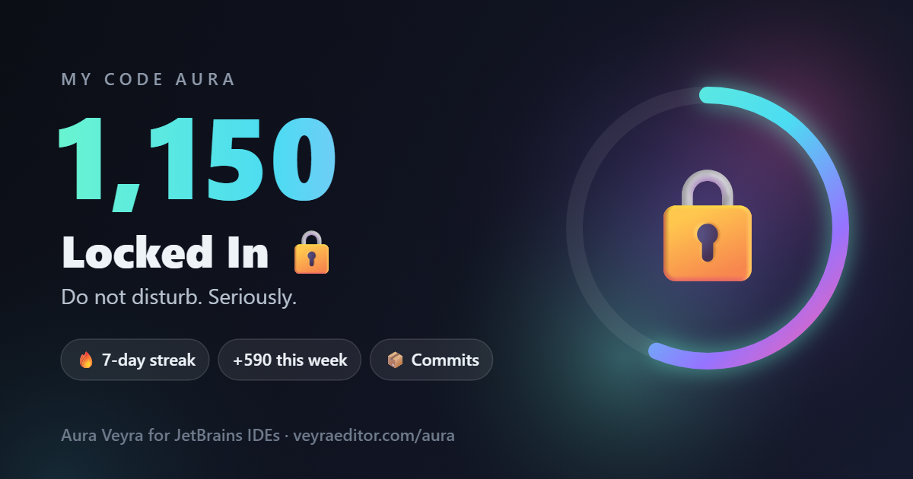
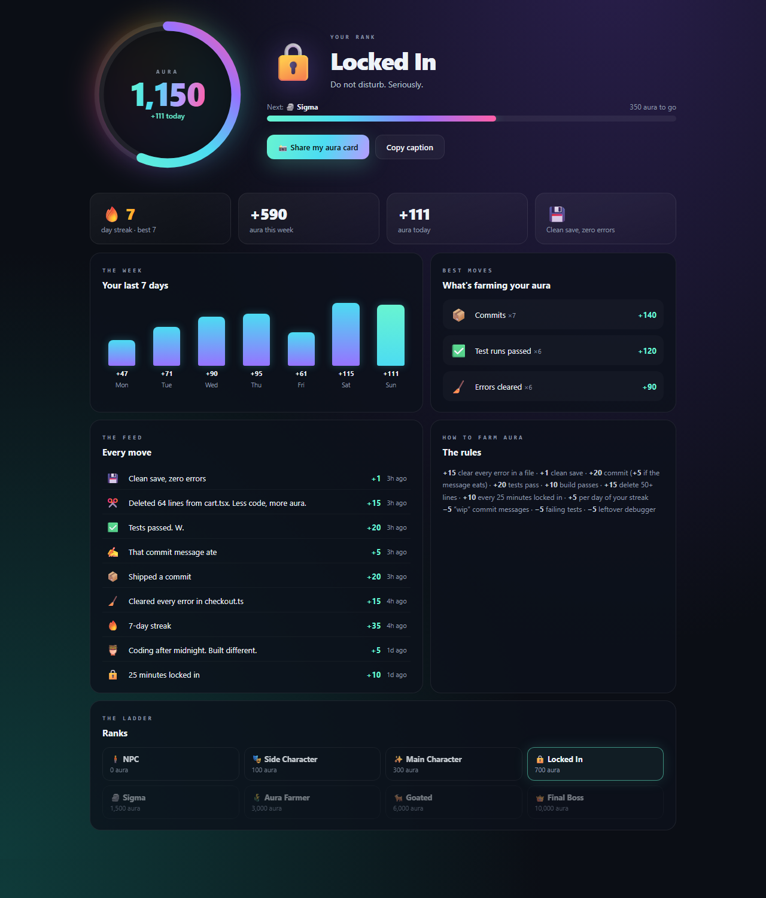

<div align="center">


# Aura Veyra ✨

**Your coding aura, in every JetBrains IDE. Farm it, flex it, share it.**

</div>



Every time you clear your errors, ship a commit or get your tests green, your aura goes up. Leave a `wip` commit message
or a `debugger` statement? That's a minus 💀. Rank up from **NPC** to **Final Boss**, keep your **🔥 streak** alive, and
share your **aura card**. Free and 100% local.

## How to farm aura

| Move | Aura |
| --- | --- |
| 🧹 Clear every error in a file | **+15** |
| 💾 Save a file with no errors | **+1** |
| 📦 Ship a commit (the Commit window, the terminal, anywhere) | **+20** |
| ✍️ …with a commit message that eats (`feat: add dark mode toggle`) | **+5** |
| ✅ Tests pass in the IDE's test runner (JUnit, pytest, Jest, Go, Kotest…) | **+20** |
| 🏗️ Build passes | **+10** |
| ✂️ Delete 50+ lines in one go | **+15** |
| 🔒 Every 25 minutes locked in | **+10** |
| 🔥 Each day of your streak | **+5** per day (up to +50) |
| 🦉 Coding after midnight | **+5** |

**Roast mode** 💀 (on by default; turn it off in Settings → Tools → Aura Veyra): **−5** for a commit message that says
nothing (`wip`, `fix`, `asdf`), **−5** failing tests, **−3** a failed build, **−5** a `debugger` statement left in a saved
JavaScript or TypeScript file.

Every move has a daily limit, so you can't farm aura by saving the same file 500 times. Nice try.

## The ranks

🧍 **NPC** (0) → 🎭 **Side Character** (100) → ✨ **Main Character** (300) → 🔒 **Locked In** (700) → 🗿 **Sigma** (1,500)
→ 🌾 **Aura Farmer** (3,000) → 🐐 **Goated** (6,000) → 👑 **Final Boss** (10,000)

## Your aura, at a glance



- Your aura and streak in the **status bar**, with each move as it happens: `+15 aura · Cleared every error in Cart.kt`.
- The **Aura** tool window (**View → Tool Windows → Aura**, or click the status bar): rank and progress, streak, your week,
  best moves and every move.
- **Tools → Aura → Share My Aura Card…**: a 1200 × 630 image for X, LinkedIn and Instagram, with the caption copied.
- A notification when you **rank up**.

## How it knows

Aura only counts what the IDE already sees, on your computer:

- **Errors**: the IDE's problem tracker (the red files in the Project view).
- **Saves and typing** in the editor.
- **Commits** from Git, however you make them: each time HEAD moves, git's reflog says whether it was a new commit
  (amends, pulls, checkouts and resets don't count).
- **Tests** from the IDE's test runner, and **builds** from Build Project.

It's stored with your IDE settings (`aura-veyra.xml`). No account, no telemetry, nothing sent anywhere.

## Building

```bash
./gradlew test          # 18 tests: the rules, and the service and listeners in a light IDE
./gradlew buildPlugin   # build/distributions/aura-veyra-1.0.0.zip
./gradlew runIde        # try it in a sandbox IDE
```

Also for VS Code, as [Veyra Aura](https://veyraeditor.com/aura). Made by [FlightCoders](https://flightcoders.com), the team
behind [Veyra Studio](https://veyraeditor.com).
