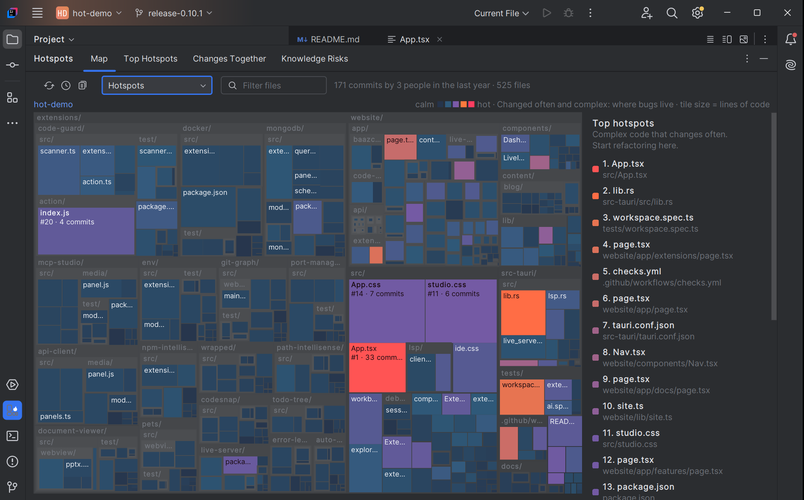
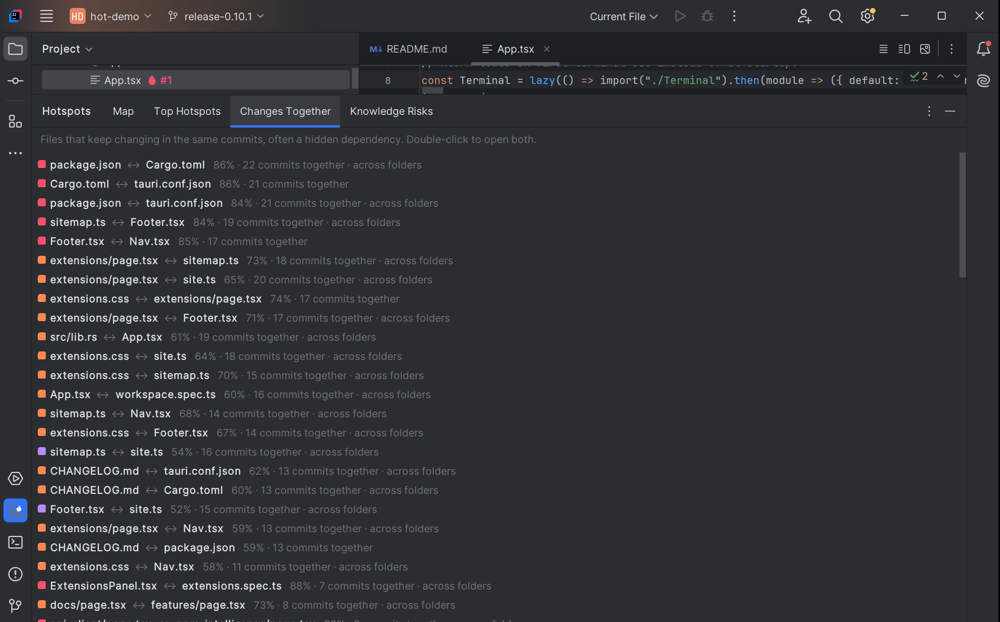

<div align="center">


# Hotspots Veyra

**A living heat map of your codebase, in every JetBrains IDE. Find the files where bugs live.**

</div>



Some files cause most of the trouble: they're complicated **and** they change all the time. Hotspots Veyra reads your
project's own git history, finds those files, and shows your whole codebase as one heat map, with who knows each file,
which files secretly change together, and the code only one person understands. Free, 100% local, nothing to configure.

## What you get

- 🔥 **The hotspot map**: every file is a tile, sized by its code and coloured by risk. Hover for details, click a file for
  its full story (with lines to the files that change with it), double-click to open, click a folder's name to zoom in.
- 🎨 **Five ways to look**: Hotspots, Change frequency, Complexity, Code age and Knowledge risk.
- 🏆 **Top Hotspots**, ranked: the files to refactor first.
- 🔗 **Changes Together**: pairs of files that keep landing in the same commits, often across folders. A hidden dependency, made visible.
- 👤 **Knowledge Risks**: files only one person has changed, and code whose only author has left.
- 🚩 **In the Project view** the hottest files get a flame and their rank, and the **status bar** shows the open file's rank.
- 💡 **Why Is This a Hotspot?** (right-click a file or an editor tab), **File History** with each commit's diff, and a Markdown **report**.



## How it's measured

- **Change frequency**: commits that touched the file in the period you choose (the last year by default), merges excluded.
- **Complexity**: lines of code and how deeply they're indented. Indentation follows nesting in every language, so it works the
  same for Java, Kotlin, Python, TypeScript, Go, Rust, C#, PHP and the rest.
- **Hotspot score**: the two multiplied, each on a log scale so one giant file doesn't flatten the rest.
- **Changes together**: two files that shared at least 4 commits, together at least 40% of the time. Huge commits are ignored.
- **Knowledge**: who changed the most lines. One person with several names or emails counts once, and `.mailmap` is respected.
  "Has left" means no commits for 6 months.

Lock files, build output, `node_modules`, minified files and generated code are left out. Change that in
**Settings → Tools → Hotspots Veyra**, along with the period, the Project view flames and the status bar.

## Install

**Settings → Plugins → Marketplace**, search for **Hotspots Veyra**. Then open **View → Tool Windows → Hotspots**, or click
**Hotspot #N** in the status bar. Works in IntelliJ IDEA, Android Studio, PyCharm, WebStorm, GoLand, PhpStorm, Rider, CLion,
RubyMine and RustRover, 2024.3 and newer.

## Private

Everything happens on your computer: Hotspots runs `git log` and reads your files, and that's all. No account, no telemetry.

## Build it yourself

```bash
./gradlew test          # the engine's unit tests
./gradlew buildPlugin   # → build/distributions/hotspots-veyra-<version>.zip
./gradlew runIde        # try it in IntelliJ IDEA
```

The same idea is also available for VS Code as [Veyra Hotspots](https://veyraeditor.com/hotspots).

## License

[MIT](LICENSE) © FlightCoders
