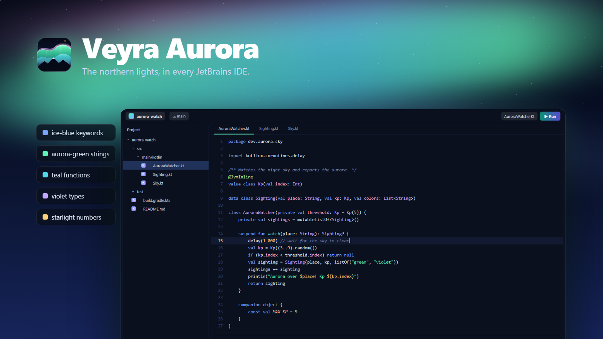
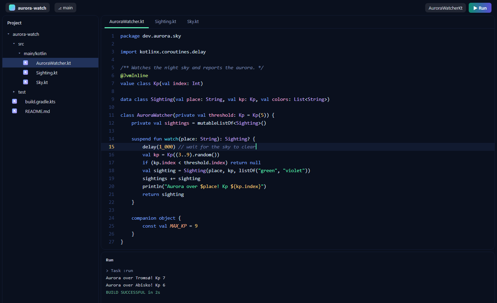
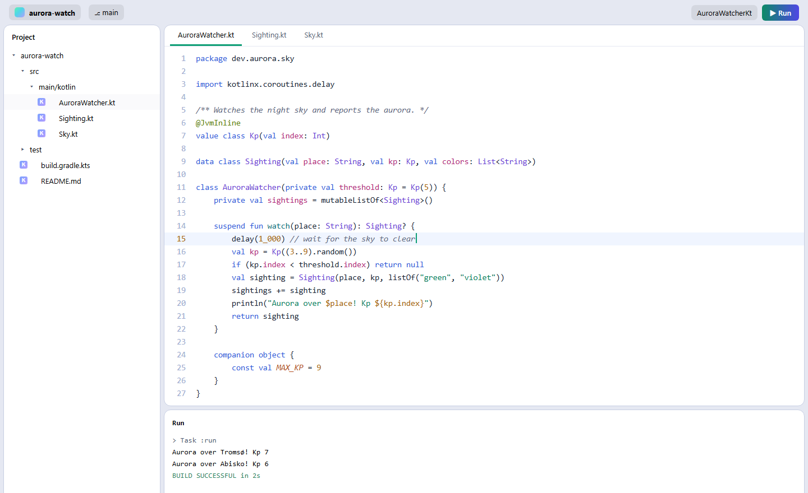

<div align="center">


# Veyra Aurora

**The northern lights, in every JetBrains IDE.**

</div>



A midnight-blue theme lit by the aurora: ice-blue keywords, aurora-green strings, teal functions, soft-violet types,
pink fields and starlight-gold numbers. Plus **Veyra Aurora Light**, the same palette deepened for a crisp white editor.
Easy on the eyes for long sessions, and beautiful in screenshots.

## Two themes

| Veyra Aurora | Veyra Aurora Light |
| --- | --- |
|  |  |

*Previews drawn with the theme's own colours. Install it to see it in your IDE.*

## The palette

| | Colour | Used for |
| --- | --- | --- |
|  | Ice blue `#7AA2FF` | Keywords, tags |
|  | Aurora green `#5EF2B5` | Strings, the caret, tab underline |
|  | Teal `#4FD6E8` | Functions, attributes, the progress bar |
|  | Soft violet `#C3A6FF` | Types and classes |
|  | Aurora pink `#F7A8D8` | Fields, labels |
|  | Starlight gold `#FFCF7A` | Numbers, escapes, the current line number |
|  | Lime `#C6F68D` | Annotations |
|  | Midnight `#0A101E` | The editor and every surface, in blue-tinted greys |

## What's themed

- **The whole IDE**: toolbars, tool windows, tabs, popups, Search Everywhere, dialogs, the Run widget, notifications,
  checkboxes and toggles, 600+ parts of the IDE. On 2025.3 and newer you get JetBrains' rounded **Islands** look.
- **Signature details**: an aurora green-to-violet default button, an aurora-green caret and tab underline, a gold
  current line number and a green-to-violet progress bar.
- **Matching editor colour schemes** for every language, plus the debugger, diffs, VCS, search highlights and the terminal.
  The scheme switches with the theme.
- **Easy to read**: every syntax colour meets **WCAG AA** contrast (4.5:1) on its background, comments included.

## Install

**Settings → Plugins → Marketplace**, search for **Veyra Aurora**, then **Settings → Appearance & Behavior → Appearance →
Theme → Veyra Aurora** (or **Veyra Aurora Light**).

## Regenerating the theme

The four files in `src/main/resources/themes` are generated from JetBrains' own New UI and Islands themes, re-coloured in
the Aurora palette, so every part of the IDE is covered:

```bash
node tools/generate.mjs <2024.3 reference dir> <2026.3 reference dir>
```

Each reference dir holds files extracted from an IntelliJ IDEA install (`expUI_*.theme.json`, `ManyIslands*.theme.json`,
`DefaultColorSchemesManager.xml`, `expUI_*Scheme.xml`, `IslandSchemeDark.xml`). Change the palette at the top of
`tools/generate.mjs`.

```bash
./gradlew buildPlugin       # build/distributions/veyra-aurora-1.0.0.zip
./gradlew runIdeLatest      # try it in IntelliJ IDEA 2026.3 with the Islands look
```

Made by [FlightCoders](https://flightcoders.com), the team behind [Veyra Studio](https://veyraeditor.com).
Prefer warm colours? Try [Veyra Theme](../veyra-theme).
