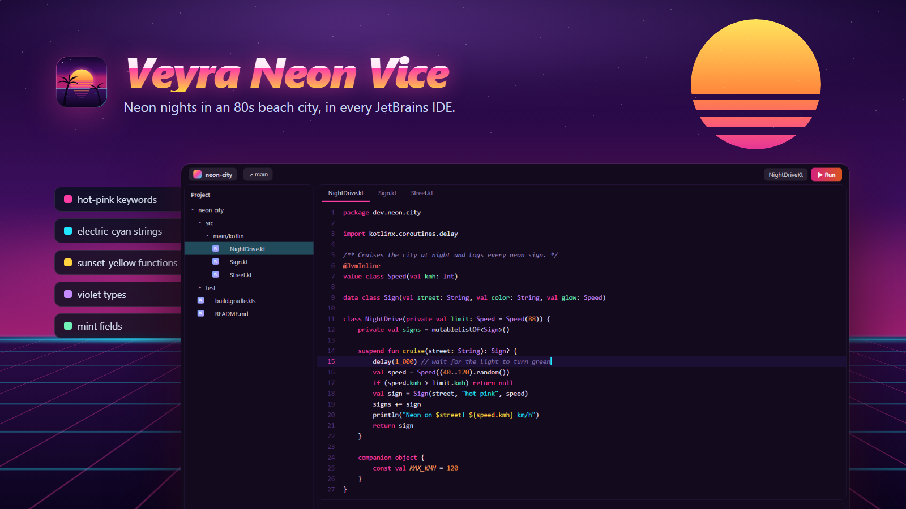
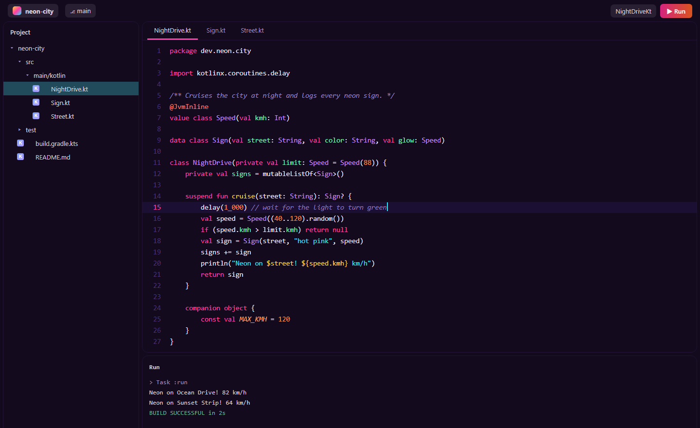
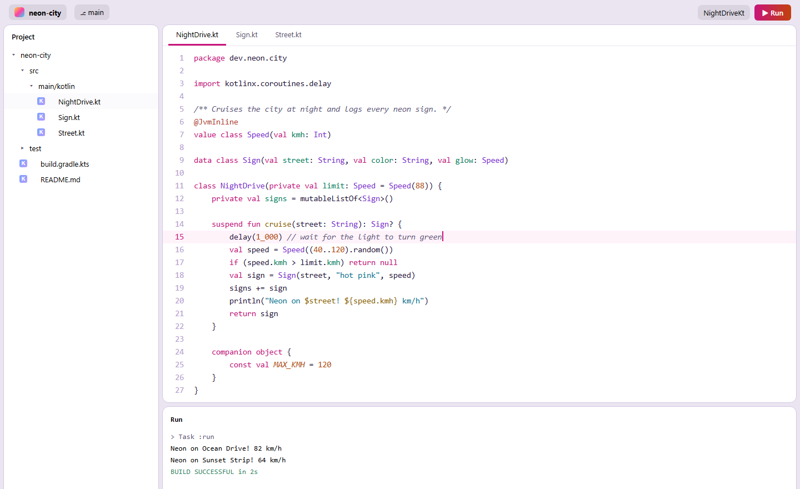

<div align="center">


# Veyra Neon Vice

**Neon nights in an 80s beach city, in every JetBrains IDE.**

</div>



Hot-pink and electric-cyan neon over a deep purple night, with a sunset of yellow and orange: hot-pink keywords,
electric-cyan strings, sunset-yellow functions, violet types, mint fields and orange numbers. Plus
**Veyra Neon Vice Daylight**, the same city by day on a crisp white editor.

## Two themes

| Veyra Neon Vice | Veyra Neon Vice Daylight |
| --- | --- |
|  |  |

*Previews drawn with the theme's own colours. Install it to see it in your IDE.*

## The palette

| | Colour | Used for |
| --- | --- | --- |
|  | Hot pink `#FF3EA5` | Keywords, tags, tab underline, current line number |
|  | Electric cyan `#22E6FF` | Strings, the caret, the progress bar |
|  | Sunset yellow `#FFD23F` | Functions, attributes, escapes |
|  | Neon violet `#C58AFF` | Types and classes |
|  | Mint `#72F1B8` | Fields, labels |
|  | Sunset orange `#FF8A3D` | Numbers |
|  | Salmon `#F97E72` | Annotations |
|  | Night `#130A1E` | The editor and every surface, in purple-tinted greys |

## What's themed

- **The whole IDE**: toolbars, tool windows, tabs, popups, Search Everywhere, dialogs, the Run widget, notifications,
  checkboxes and toggles, 1,200+ UI keys. On 2025.3 and newer you get JetBrains' rounded **Islands** look.
- **Signature details**: a pink-to-orange sunset default button, a hot-pink tab underline, an electric-cyan caret, a pink
  current line number and a pink-to-cyan progress bar.
- **Matching editor colour schemes** for every language, plus the debugger, diffs, VCS, search highlights and the terminal.
  The scheme switches with the theme.
- **Easy to read**: every syntax colour meets **WCAG AA** contrast (4.5:1) on its background, comments included.

## Install

**Settings → Plugins → Marketplace**, search for **Veyra Neon Vice**, then **Settings → Appearance & Behavior → Appearance
→ Theme → Veyra Neon Vice** (or **Veyra Neon Vice Daylight**).

## Regenerating the theme

The four files in `src/main/resources/themes` are generated from JetBrains' own New UI and Islands themes, re-coloured in
the Neon Vice palette, so every part of the IDE is covered:

```bash
node tools/generate.mjs <2024.3 reference dir> <2026.3 reference dir>
```

Each reference dir holds files extracted from an IntelliJ IDEA install (`expUI_*.theme.json`, `ManyIslands*.theme.json`,
`DefaultColorSchemesManager.xml`, `expUI_*Scheme.xml`, `IslandSchemeDark.xml`). Change the palette at the top of
`tools/generate.mjs`.

```bash
./gradlew buildPlugin       # build/distributions/veyra-neon-vice-1.0.0.zip
./gradlew runIdeLatest      # try it in IntelliJ IDEA 2026.3 with the Islands look
```

Made by [FlightCoders](https://flightcoders.com), the team behind [Veyra Studio](https://veyraeditor.com).
More themes: [Veyra Aurora](../veyra-aurora) and [Veyra Theme](../veyra-theme).
