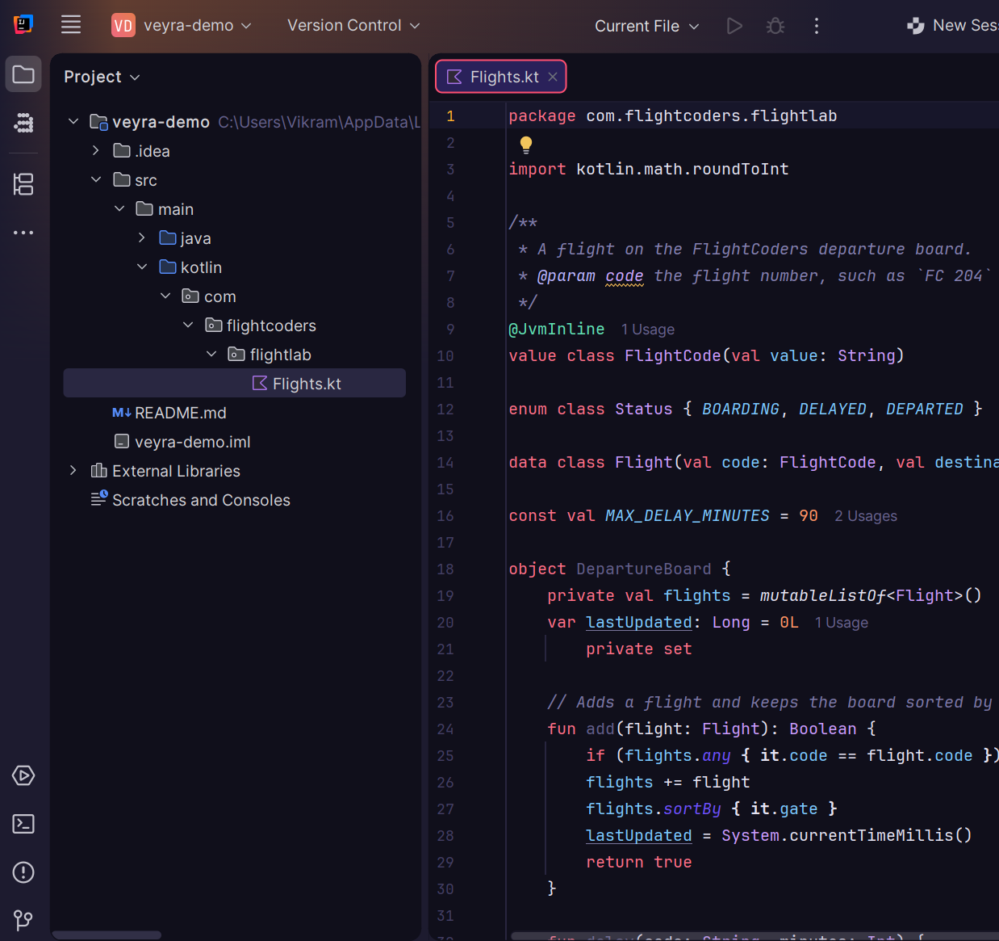
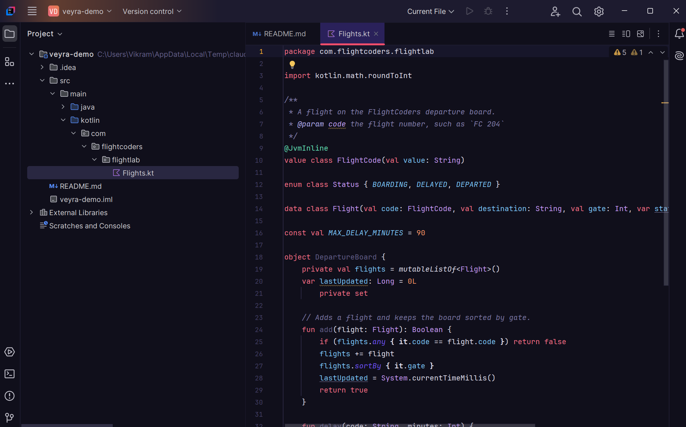
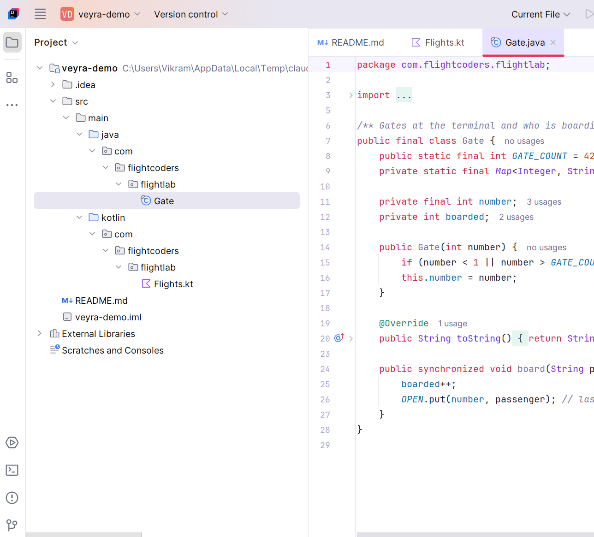

<div align="center">


# Veyra Theme

**A warm, modern dark and light theme for every JetBrains IDE, in the FlightCoders colours:
coral, amber and violet on deep ink.**

</div>



## Two themes

| Veyra Dark | Veyra Light |
| --- | --- |
|  |  |

- **Veyra Dark**: a deep ink-violet background that's easy on the eyes for long sessions, with glowing coral, amber and violet accents.
- **Veyra Light**: soft lavender paper with crisp, high-contrast code.

## What's themed

- **The whole IDE**: toolbars, tool windows, tabs, popups, Search Everywhere, dialogs, the Run widget, notifications,
  checkboxes and toggles. On 2025.3 and newer you get JetBrains' rounded **Islands** look.
- **Signature details**: coral-to-violet default buttons, a coral caret and tab underline, an amber current line number,
  amber completion matches and an amber-to-violet progress bar.
- **Matching editor colour schemes** for every language, plus the debugger, diffs, VCS, search highlights and the terminal.
  The scheme switches with the theme.

## The palette

| | Colour | Used for |
| --- | --- | --- |
|  | Coral `#FF4F6D` | Keywords, tags, caret, tab underline, buttons |
|  | Amber `#FFB02E` | Strings, current line number, completion matches |
|  | Violet `#9B3DFF` | Types and classes, button gradients |
|  | Indigo `#5B45FF` | Selection, toggles, links (light) |
|  | Lavender `#B8B4FF` | Function declarations, attributes, links (dark) |
|  | Ink `#0B0C16` | The dark background family |

Every syntax colour clears WCAG AA contrast on its background (code 5:1 to 15:1, comments about 4.5:1).

## Install

1. **Settings → Plugins → Marketplace**, search for **Veyra Theme** and install it.
   Before it's on the Marketplace: **Settings → Plugins → ⚙ → Install Plugin from Disk…** and pick the `.zip`
   from [`build/distributions`](#build-it-yourself) or a CI run.
2. **Settings → Appearance & Behavior → Appearance → Theme** → **Veyra Dark** or **Veyra Light**.

Works with IntelliJ IDEA, WebStorm, PyCharm, PhpStorm, GoLand, Rider, CLion, RubyMine, DataGrip, RustRover and
Android Studio, version 2024.3 and newer.

## Build it yourself

```bash
./gradlew buildPlugin            # → build/distributions/veyra-theme-<version>.zip
./gradlew runIde                 # try it in IntelliJ IDEA 2024.3
./gradlew runIdeLatest           # try it in IntelliJ IDEA 2026.3, with the Islands look
./gradlew runIde -PdemoProject=/path/to/a/project   # open a project straight away
```

## How it's made (regenerating)

The four files in [`src/main/resources/themes`](src/main/resources/themes) are generated by
[`tools/generate.mjs`](tools/generate.mjs). It starts from JetBrains' own New UI and Islands themes, so every one of
their 600+ UI keys and every language in the editor is covered, and re-colours them in the FlightCoders palette:

- Each JetBrains colour family moves to a Veyra hue (blue → indigo, purple → violet, red → coral, yellow → amber,
  green → mint) **with its lightness kept**, so JetBrains' tuned contrast is kept too. Greys become ink-violet.
- The hand-picked brand colours at the top of the generator always win: syntax colours, buttons, links, the caret and so on.
  Wherever JetBrains used one of its default syntax colours in a language-specific key, Veyra uses the replacement,
  so every language matches.
- Colour references are resolved to hex, because IDEs before 2025.3 can't follow a colour that names another colour.

To change a colour, edit the generator and run it against the theme files from an IntelliJ IDEA install
(oldest IDE first, so newer keys win):

```bash
node tools/generate.mjs <refs-2024.3> <refs-2026.3>
```

Each reference folder holds `expUI_dark.theme.json`, `expUI_light.theme.json` (and, from 2025.3,
`ManyIslandsDark.theme.json`, `ManyIslandsLight.theme.json`, `IslandSchemeDark.xml`) plus
`DefaultColorSchemesManager.xml`, `expUI_darkScheme.xml` and `expUI_lightScheme.xml`, unzipped from the IDE's `lib/*.jar`.
Commit the regenerated files.

## License

[MIT](LICENSE) © FlightCoders
